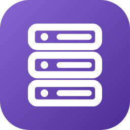

# 国内外云服务器产品调研（2026-10）

覆盖 **中国大陆 27 项 + 海外 22 项** 云服务器产品（IaaS 云主机 / VPS / 轻量应用服务器），四品类全覆盖：大厂云、IDC 与独立云商、轻量应用、免费用量档。

## 文件说明

| 文件 | 内容 |
|---|---|
| `index.html` | 报告首页入口（GitHub Pages 根页面） |
| `中国云服务器产品调研2026.html` | 国内 27 条目的完整调研（含评分对比图与价格散点图） |
| `海外云服务器产品调研报告.html` | 海外 22 项产品的完整调研（含评分对比图与价格散点图） |
| `README.md` | 本说明文件 |

## 数据口径

- 信息获取时间：2026-10-08（北京时间）
- 评分：10 分制主观共识分，综合官方价格文档、科技媒体横评结论与用户社区口碑；维度为入门档价格与续费价差、免费额度实用度、区域与线路覆盖、备案与合规便利度、控制台与文档完备度、稳定性与工单响应，跨品类不宜直接横向比较
- 免费额度：区分「永久免费档」（Oracle Always Free、Google Cloud 免费层 e2-micro、AWS 40+ 永久免费项）、「限时免费试用」（阿里云 ECS 个人 300 元 / 企业 660 元总额度、腾讯云 CVM 免费 1 个月、华为云 Flexus L 免费 1 个月、Azure $200 额度 30 天）与「无免费额度」，并逐条写明限制（例如阿里云免费试用实例不支持 ICP 备案）
- 价格：国内人民币；海外 USD 原值并按 1 USD≈7.1 CNY 约合（量级参考），欧元档先按 €1≈$1.08 折美元再换算
- 所有价格与免费额度均以官方定价页为最终依据，无法核实一律标「待确认」，未作推测填补
- 价格散点图横轴为「最低付费月费」，完全免费记 0；年付促销价按 ÷12 折算为月费口径

## 快速结论

- 国内第一梯队：阿里云 ECS（9.2）、腾讯云 CVM（9.0）、华为云 ECS（8.8）、AWS 中国 EC2（8.6）、火山引擎 ECS（8.4）；轻量档阿里云轻量（8.7）、腾讯云轻量（8.5）领先
- 海外第一梯队：AWS EC2（9.3）、Azure VM（9.1）、Google Compute Engine（9.0）、Oracle Always Free（8.9）、DigitalOcean（8.8）
- 价格两头分化：国内入门档被压到 38–99 元/年（七牛云 2 核 2G 66 元/年、阿里云经济型 e 99 元/年、腾讯云轻量 4 核 4G 109 元/年），同一时间大厂在涨价（阿里云与百度智能云 3 月同日官宣调价）；海外本轮涨价集中在 2026 上半年，谷歌云 5-01 起调价（北美部分网络服务 $0.04→$0.08/GB）、Hetzner 6-15 起落地（入门 VPS €4.49→€6.49）、OVHcloud 10-01 起 Public Cloud 涨 1.4%–21.9%
- 备案是中国大陆云主机真正的准入门槛：只有中国内地地域实例可申请备案服务码，腾讯云要求备案用实例为包年包月且购买 3 个月以上，免费试用实例普遍不能备案
- 免费额度只有少数是长期档：海外为 Oracle Always Free（2 台 AMD VM + 4 OCPU/24GB Ampere A1 + 200GB 块存储 + 每月 10TB 出站）与 Google Cloud 免费层（每月 1 台 e2-micro，限 us-west1/us-central1/us-east1）

## 重要纠错（已核验）

- **又拍云**在本轮检索中未发现对外售卖的云主机 / VPS 产品线（主业为 CDN、云存储与音视频处理），按「非此类产品」处理，不进主表
- **Rackspace**已从自助公有云转型为托管云与专业服务，官网不再提供标准自助 VPS 购买路径与公开单价，作为对照条目列出并明确不参与单价比较
- **AWS 免费档已按注册时间分层**：2025-07-15 之后注册的账号为 Free Plan（免费额度 6 个月或 credit 用尽为止），此前注册的账号保留 12 个月 t2/t3.micro 每月 750 小时；比较「AWS 免费额度」前必须先确认账号注册时间
- **AWS 中国区免费档分区计算**：北京（光环新网运营）与宁夏（西云数据运营）的免费使用量分别计算，t4g.small 每月 750 小时活动页标注截止 2026-07-31，是否延续待确认
- **Azure $200 试用额度不适用于中国区**：Azure 中国由世纪互联运营，与国际站版本、区域与促销不同步
- **IBM Cloud 免费虚拟服务器**仅列出 Hyper Protect Virtual Server（LinuxONE，1 vCPU 口径），未见永久免费 x86 VSI，按「部分具备，待确认」处理
- **「永久免费 VPS」聚合页与「低于官网价」的代理页**均为非官方渠道，本轮列入排除清单，不作为价格依据
